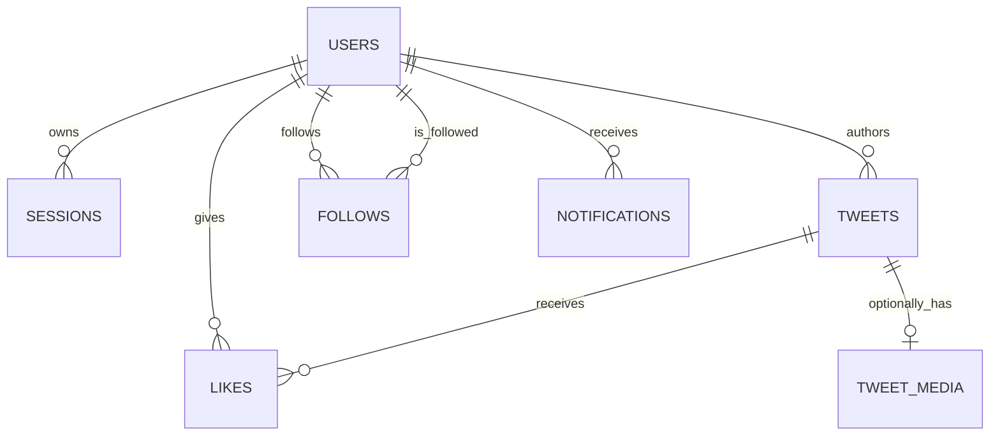

# Database model proposal

PostgreSQL is the source of truth. All timestamps are `timestamptz` in UTC; primary IDs are UUIDv7 generated by the application or database-supported equivalent. Drizzle migrations are reviewed SQL artifacts.

## Entity relationship

## Core tables

### `users`

| Column                     | Type                 | Rules                                           |
| -------------------------- | -------------------- | ----------------------------------------------- |
| `id`                       | uuid                 | PK                                              |
| `email`                    | text                 | original/canonical value, not publicly returned |
| `email_normalized`         | text                 | unique, lowercase normalization                 |
| `username`                 | varchar(30)          | unique normalized lowercase; check regex/length |
| `display_name`             | varchar(80)          | required                                        |
| `bio`                      | varchar(160)         | not null default empty                          |
| `avatar_key`               | text nullable        | null means deterministic placeholder            |
| `password_hash`            | text                 | Argon2id encoded hash                           |
| `created_at`, `updated_at` | timestamptz          | not null                                        |
| `deleted_at`               | timestamptz nullable | reserved for defined deletion policy            |

Indexes: unique `email_normalized`; unique `username`; search indexes described below.

Profile reads load this row by `username` and do not store follower, following, or tweet counts. Counts are aggregated from committed follow and tweet rows. The read does not return `email`, `password_hash`, or `avatar_key`.

### `sessions`

| Column                                     | Type                 | Rules                                  |
| ------------------------------------------ | -------------------- | -------------------------------------- |
| `id`                                       | uuid                 | PK                                     |
| `user_id`                                  | uuid                 | FK users, cascade                      |
| `token_hash`                               | bytea                | unique; raw token never stored         |
| `csrf_secret_hash`                         | bytea                | session-bound CSRF material            |
| `created_at`, `last_seen_at`, `expires_at` | timestamptz          | not null                               |
| `revoked_at`                               | timestamptz nullable | invalid when set                       |
| `user_agent_hash`, `ip_prefix`             | text nullable        | optional privacy-conscious diagnostics |

Indexes: unique `token_hash`; `(user_id, expires_at)`; partial cleanup index for active sessions.

### `tweets`

| Column       | Type                 | Rules                                                            |
| ------------ | -------------------- | ---------------------------------------------------------------- |
| `id`         | uuid                 | PK                                                               |
| `author_id`  | uuid                 | FK users, restrict account deletion until policy handles content |
| `content`    | varchar(280)         | check non-empty after trim and max 280                           |
| `created_at` | timestamptz          | immutable                                                        |
| `updated_at` | timestamptz nullable | reserved; editing is not a v1 feature                            |

Indexes: `(author_id, created_at DESC, id DESC)` and `(created_at DESC, id DESC)`.

### `follows`

| Column         | Type        | Rules             |
| -------------- | ----------- | ----------------- |
| `follower_id`  | uuid        | FK users, cascade |
| `following_id` | uuid        | FK users, cascade |
| `created_at`   | timestamptz | not null          |

Composite PK `(follower_id, following_id)`; check `follower_id <> following_id`; reverse index `(following_id, created_at DESC, follower_id)` for follower lists; index `(follower_id, created_at DESC, following_id)` for following lists.

### `likes`

| Column       | Type        | Rules              |
| ------------ | ----------- | ------------------ |
| `user_id`    | uuid        | FK users, cascade  |
| `tweet_id`   | uuid        | FK tweets, cascade |
| `created_at` | timestamptz | not null           |

Composite PK `(user_id, tweet_id)`; index `(tweet_id, created_at DESC, user_id)` supports counts/lists.

## Optional tables (create only in bonus milestones)

- `tweet_media(tweet_id PK/FK, object_key UNIQUE, mime_type, byte_size, width, height, status, created_at)`.
- `notifications(id, recipient_id, actor_id, type, tweet_id nullable, dedupe_key UNIQUE, read_at, created_at)` with recipient cursor index.
- `outbox_events(id, aggregate_type, aggregate_id, event_type, payload jsonb, created_at, published_at)` for reliable notification delivery.

## Timeline query shape

The home feed reads one PostgreSQL snapshot. It unions the viewer ID with their followed IDs (the unique/self-follow constraints make them disjoint), excludes deleted authors, then uses a lateral index seek on `tweets(author_id, created_at DESC, id DESC)` for each eligible author. Both the per-author and merged reads cap at `limit + 1`. A bounded final projection gathers like counts and viewer-liked state in that same query; there are no per-card database round trips.

Continuation adds the strict tuple predicate `(created_at, id) < (cursor_time, cursor_id)`. The cursor signs a UTC timestamp with **six** fractional digits and the UUID; do not convert it to a JavaScript Date or look up the anchor tweet. A representative sparse-feed test runs `EXPLAIN (ANALYZE, BUFFERS)` on the production query.

## Search proposal

For this light product, use normalized columns plus `pg_trgm` indexes on `username` and `lower(display_name)`. Escape `%`, `_`, and backslash for literal substring matching; rank exact username, username prefix, then similarity/display name. Re-evaluate full-text search only when requirements include bios/tweets or linguistic search.

## Retention and cleanup

- Scheduled job deletes expired/revoked sessions after a short diagnostic window.
- Tweet deletion cascades likes and optional media metadata; object deletion is an idempotent asynchronous cleanup.
- Account deletion remains blocked from public release until content/anonymization, notification, backup, and legal retention rules are approved.

## Migration guardrails

- Constraints are database-enforced even when validated in Zod.
- Large backfills are batched; new required columns use expand/backfill/validate/contract.
- Migration names are timestamped and immutable. CI runs from empty and previous release schemas.

FEED-01 adds empty `follows` and `likes` tables; it does not rewrite existing users or tweets. Apply before the API rollout. To roll back the API, leave these additive tables in place and forward-fix with a new migration; do not drop social data. SOC-01 serves follow and unfollow on the existing `follows` table and adds no migration. Like writes remain in SOC-02.
