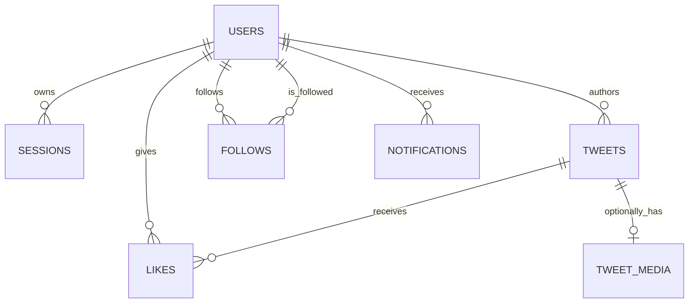

# Database model proposal

PostgreSQL is the source of truth. All timestamps are `timestamptz` in UTC; primary IDs are UUIDv7 generated by the application or database-supported equivalent. Drizzle migrations are reviewed SQL artifacts.

## Entity relationship

## Core tables

### `users`

| Column                     | Type                 | Rules                                           |
| -------------------------- | -------------------- | ----------------------------------------------- |
| `id`                       | uuid                 | PK                                              |
| `email`                    | text                 | original/canonical value, not publicly returned |
| `email_normalized`         | text                 | unique, lowercase normalization                 |
| `username`                 | varchar(30)          | unique normalized lowercase; check regex/length |
| `display_name`             | varchar(80)          | required                                        |
| `bio`                      | varchar(160)         | not null default empty                          |
| `avatar_key`               | text nullable        | null means deterministic placeholder            |
| `password_hash`            | text                 | Argon2id encoded hash                           |
| `created_at`, `updated_at` | timestamptz          | not null                                        |
| `deleted_at`               | timestamptz nullable | reserved for defined deletion policy            |

Indexes: unique `email_normalized`; unique `username`; search indexes described below.

Profile reads load this row by `username` and do not store follower, following, or tweet counts. Counts are aggregated from committed follow and tweet rows. The read does not return `email`, `password_hash`, or `avatar_key`.

### `sessions`

| Column                                     | Type                 | Rules                                  |
| ------------------------------------------ | -------------------- | -------------------------------------- |
| `id`                                       | uuid                 | PK                                     |
| `user_id`                                  | uuid                 | FK users, cascade                      |
| `token_hash`                               | bytea                | unique; raw token never stored         |
| `csrf_secret_hash`                         | bytea                | session-bound CSRF material            |
| `created_at`, `last_seen_at`, `expires_at` | timestamptz          | not null                               |
| `revoked_at`                               | timestamptz nullable | invalid when set                       |
| `user_agent_hash`, `ip_prefix`             | text nullable        | optional privacy-conscious diagnostics |

Indexes: unique `token_hash`; `(user_id, expires_at)`; partial cleanup index for active sessions.

### `tweets`

| Column       | Type                 | Rules                                                            |
| ------------ | -------------------- | ---------------------------------------------------------------- |
| `id`         | uuid                 | PK                                                               |
| `author_id`  | uuid                 | FK users, restrict account deletion until policy handles content |
| `content`    | varchar(280)         | check non-empty after trim and max 280                           |
| `created_at` | timestamptz          | immutable                                                        |
| `updated_at` | timestamptz nullable | reserved; editing is not a v1 feature                            |

Indexes: `(author_id, created_at DESC, id DESC)` and `(created_at DESC, id DESC)`.

### `follows`

| Column         | Type        | Rules             |
| -------------- | ----------- | ----------------- |
| `follower_id`  | uuid        | FK users, cascade |
| `following_id` | uuid        | FK users, cascade |
| `created_at`   | timestamptz | not null          |

Composite PK `(follower_id, following_id)`; check `follower_id <> following_id`; reverse index `(following_id, created_at DESC, follower_id)` for follower lists; index `(follower_id, created_at DESC, following_id)` for following lists.

### `likes`

| Column       | Type        | Rules              |
| ------------ | ----------- | ------------------ |
| `user_id`    | uuid        | FK users, cascade  |
| `tweet_id`   | uuid        | FK tweets, cascade |
| `created_at` | timestamptz | not null           |

Composite PK `(user_id, tweet_id)`; index `(tweet_id, created_at DESC, user_id)` supports counts/lists.

## Notifications (NOT-01)

Migration `notifications` adds `notifications(id, recipient_id, actor_id, type, tweet_id nullable, dedupe_key UNIQUE, read_at, created_at)`.

- `type` is `follow`, `like` or `reply`; a check requires `tweet_id` for likes and replies only (the liked tweet, or the new reply) and another forbids `actor_id = recipient_id`.
- `dedupe_key` is `follow:{actor}:{recipient}`, `like:{actor}:{tweet}` or `reply:{reply}`; inserts use `ON CONFLICT DO NOTHING`, so repeats and concurrent retries notify once.
- Rows are written by the follow, like and reply commands in their own transaction. This gives the outbox's guarantee (no notification without its action, none lost) without a relay worker; a separate outbox is only worth adding if live delivery has to publish outside PostgreSQL.
- Foreign keys cascade from the recipient, the actor and the tweet, so deleting a tweet or reply removes its notifications.
- `notifications_recipient_created_id_idx (recipient_id, created_at DESC, id DESC)` serves the page; the partial `notifications_recipient_unread_idx (recipient_id) WHERE read_at IS NULL` serves the badge count.
- Rollback: stop serving the routes and the writes; the table is additive and can stay.

## Optional tables (create only in bonus milestones)

- `tweet_media(tweet_id PK/FK, object_key UNIQUE, mime_type, byte_size, width, height, status, created_at)`.
- `outbox_events(id, aggregate_type, aggregate_id, event_type, payload jsonb, created_at, published_at)`: not used. LIVE-01 publishes in-process after commit and recovers missed events from `tweets` on SSE reconnect.

## Timeline query shape

The home feed reads one PostgreSQL snapshot. It unions the viewer ID with their followed IDs (the unique/self-follow constraints make them disjoint), excludes deleted authors, then uses a lateral index seek on `tweets(author_id, created_at DESC, id DESC)` for each eligible author. Both the per-author and merged reads cap at `limit + 1`. A bounded final projection gathers like counts and viewer-liked state in that same query; there are no per-card database round trips.

Continuation adds the strict tuple predicate `(created_at, id) < (cursor_time, cursor_id)`. The cursor signs a UTC timestamp with **six** fractional digits and the UUID; do not convert it to a JavaScript Date or look up the anchor tweet. A representative sparse-feed test runs `EXPLAIN (ANALYZE, BUFFERS)` on the production query.

## Search

SRC-01 migration `user_search_trigram` enables `pg_trgm` (a trusted extension: the database owner can create it without superuser) and adds GIN trigram indexes `users_username_trgm_idx` on `username` and `users_display_name_trgm_idx` on `lower(display_name)`. It only adds indexes; no rows change. Search escapes `%`, `_` and backslash and matches literal substrings with `LIKE ... ESCAPE '\'`; it ranks exact username, username prefix, display-name prefix, then other substrings, with the unique username as the tie-breaker. Trigram indexes serve text of three or more characters; two-character text is valid but may scan, which is acceptable at this product size. To roll back, drop the two indexes (leaving the extension is harmless). Re-evaluate full-text search only when requirements include bios/tweets or linguistic search.

## Retention and cleanup

- Scheduled job deletes expired/revoked sessions after a short diagnostic window.
- Tweet deletion cascades likes and optional media metadata; object deletion is an idempotent asynchronous cleanup.
- Account deletion remains blocked from public release until content/anonymization, notification, backup, and legal retention rules are approved.

## Migration guardrails

- Constraints are database-enforced even when validated in Zod.
- Large backfills are batched; new required columns use expand/backfill/validate/contract.
- Migration names are timestamped and immutable. CI runs from empty and previous release schemas.

FEED-01 adds empty `follows` and `likes` tables; it does not rewrite existing users or tweets. Apply before the API rollout. To roll back the API, leave these additive tables in place and forward-fix with a new migration; do not drop social data. SOC-01 serves follow and unfollow on the existing `follows` table and adds no migration. SOC-02 serves like and unlike on the existing `likes` table and adds no migration either.

## Thread storage and migration (THR-01)

`tweets.parent_tweet_id` is nullable for roots and references `tweets.id ON DELETE CASCADE`; the child index supports deletes. An insert trigger requires a pre-existing parent and advances a reply's creation instant to at least one microsecond after that parent if needed. Parent and creation instant cannot be rewritten, so cycles cannot be introduced. Existing tweets stay roots without a data backfill.

A recursive walk followed by sorting and limiting would visit an entire subtree even to serve the first anonymous page. Instead, `tweet_descendants` stores only proper ancestor/descendant pairs, with an index on `(ancestor_id, created_at, descendant_id)`. The insert trigger copies the parent's ancestors plus the parent itself transactionally. This makes indexed keyset reads possible from any selected node; a reply costs O(depth) extra rows, and a long chain can require quadratic storage. The broad-thread integration fixture exercises the real query with `EXPLAIN (ANALYZE, BUFFERS)`.

Reply writes take a shared lock on the conversation root; deletes take an exclusive lock there before walking the subtree. This common lock order prevents a new reply from interleaving ancestor-index writes with cascade deletes in reverse order. Unrelated conversations remain independent. **Local challenge only:** synchronous cascades can hold locks, amplify writes and exhaust database resources on very large or deep trees. Production should revisit quotas, retention and batched deletion or tombstones rather than copying this approach.

Apply the additive migration before the API. An API rollback can leave the tables, nullable column, triggers and indexes in place. Already-written replies stay protected by cascade semantics; forward-fix any schema issue without dropping their data.
